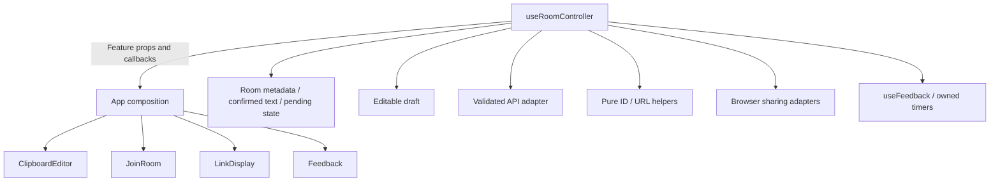

# Client ownership boundaries

Runtime API URL resolution is isolated in `client/src/config.js`. Development
defaults to the local API; production defaults to the current origin's `/api`.
Configured URLs must be absolute HTTP(S), without credentials, query or fragment;
trailing slashes normalize before route composition. Secure pages reject HTTP
API targets to prevent mixed-content failures. Local overrides belong in the
project README and environment example.

`client/src/api.js` owns fetch construction, JSON/error decoding and response
validation. Room methods validate IDs, timestamps, counts, optional legacy
revision metadata and read text fidelity while allowing compatible extra fields.
Deletion accepts an empty 204. Non-JSON failures produce a generic error without
echoing the response body; structured errors retain status, code and retry hints.

Pure room-location helpers own case-sensitive IDs and HTTP(S) query links.
Duplicate room parameters, invalid encodings and unsupported path-only links are
rejected. Navigation updates preserve unrelated query/fragment state; generated
share links include only the room parameter so unrelated URL data is not shared.

Room metadata, pending operation and draft/active/deleted phases now transition
through a reducer. A failed mutation retains the prior room and draft.
Editable text is independent from the confirmed snapshot held with room metadata.
Dirty state compares those exact strings. Creating a room no longer trims the
editor, matching the corrected server fidelity contract; edits become confirmed
only after a successful save. No browser persistence is introduced.

`features/editor/ClipboardEditor.jsx` owns editor, expiry and mutation controls.
Its explicit props contain editable text, metadata, dirty/pending state and
callbacks. It performs no fetch, URL mutation or browser sharing operation.

`features/join/JoinRoom.jsx` owns the labelled join input and native form. Manual,
query-link and automatic joins share parsing and orchestration; the panel owns
no room state or independent request path.

Browser sharing is behind injectable clipboard, QR and download adapters. QR
payloads contain the current share link, downloads use generated PNG data URLs,
and unsupported/denied operations reject without an uncontrolled promise error.

`useFeedback` owns copy results, notices and their timers. Later copies invalidate
earlier completions, replacement notices reset their lifetime, and unmount
cancels timers and invalidates in-flight feedback. One live presentation renders
these results; the adapters do not create independent notifications.

## Composition and state ownership

App now composes navigation, editor, join, share and feedback. The controller
hook owns request orchestration and exposes explicit feature props; it is the
only owner of active metadata, draft, pending operations and URL changes.

This extraction preserves explicit-save behavior and current presentation.
Structural separation alone does not establish race safety; the implemented
guarantees below are backed by delayed-response and navigation regressions.

## Implemented async guarantees

Each room read owns an AbortController and a task identity. Superseding a read
aborts it, and late success/error/finally work is ignored unless that identity
is still current. Unmount aborts the active read and invalidates its identity.

The API adapter owns a 15-second deadline covering fetch and body consumption.
Every exit removes its timer and caller-abort listener. Timeout, deliberate
cancellation and network failure have separate codes; server status/code/retry
hints remain intact. A cancelled join retains its draft. Mutation timeout is
uncertain completion and never implies that the server did not apply the save.

URL, debounced and manual joins share the current room-read promise. StrictMode
effect replay queues initial URL work until the live effect is known, avoiding a
duplicate initial fetch. Cancelling a join suppresses automatic restart for that
input; a deliberate manual retry can start it again.

Pending state belongs to an operation identity, not a shared boolean. Mutations
invalidate reads, duplicate mutations are blocked synchronously, and only the
current operation may confirm metadata, report an error or clear loading.
Unmount aborts and invalidates all active request ownership. An old read's
finally handler cannot clear a later save or revive a deleted room.

Save confirms the exact text snapshot submitted by that action. It does not
replace the editable draft on success. Typing during either create or update
therefore remains visible and dirty relative to the newly confirmed snapshot;
delayed-mutation regressions enforce this ownership rule.

Joining with a dirty draft requires an explicit stay/discard decision before the
request begins. Typing during an initially clean read triggers the same guard
before its result can replace the draft. Stay keeps the active room and text;
discard requests the target afresh. Query joins use this same controller path.

Saves send the last confirmed revision when available. A 412 retains the draft
and exposes reload or keep-draft recovery. Reload uses the dirty-draft guard;
keep-draft fetches the latest server snapshot/revision without changing local
text. The user must review and explicitly save again. Recovery never silently
replays PUT, and legacy servers without revision metadata remain usable.

Popstate restores room state through the same join guard; navigating to a blank
workspace clears local state without deleting the remote room. Staying with a
dirty draft restores its prior URL. Invalid links and navigation during mutation
retain the active state. Query writes preserve unrelated parameters, fragments
and history state. Deletion removes only the room parameter.

Read recovery is deliberate: retryable connection, timeout, 429 and transient
gateway/capacity failures expose a retry action after a bounded server hint.
Seconds or HTTP-date hints are capped at 30 seconds; absent hints wait one second.
Failed/cancelled input is not automatically joined again. No read retry loops,
polling or background mutation retries run. POST/PUT/DELETE uncertainty always
requires a user decision rather than replaying a request.

Adversarial controller fixtures cover reordered reads, same-turn duplicate saves,
typing during save/read, delete-then-late-read, cancellation and unmount without
remaining timers. Real-API Chrome journeys use independent contexts for revision
conflicts, dirty switches, back/forward and deliberate network recovery. These
are automated local results, not manual mobile or cross-browser certification.
