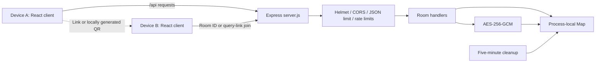
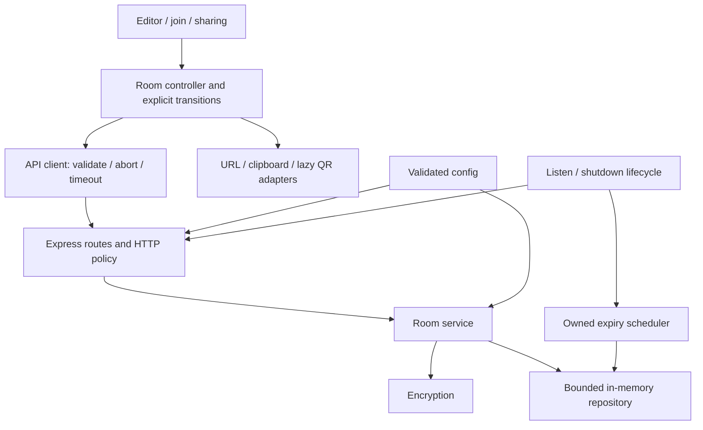

# Clipboard system design

Status: source reviewed on 2026-10-28. Current behavior is separated from the
proposed refactor; proposed modules, tests, CI and resource controls do not yet
exist. See the [roadmap](roadmap.md) for delivery boundaries.

## Product scope

Users create temporary text rooms, share an ID/link/QR code, read or update text,
and delete a room or wait for expiry. Anyone holding its ID can read, update or
delete it. Retain explicit saves and encrypted process-local storage.

Accounts, room history, uploads, live collaboration, analytics, automatic browser
text persistence, and durable/distributed storage are outside the baseline plan.

## Verified current architecture



HTTPS is a deployment requirement in the README, not a transport provided by
the local API listener. There is no database, queue, WebSocket service or worker.

| Source | Current responsibility | Refactor motivation |
| --- | --- | --- |
| `client/src/App.jsx` (506 lines) | Fetch, URL parsing, room state, mutations, auto-join, QR, clipboard API, timers, editor/join markup | Async behavior and presentation are tightly coupled |
| `client/src/components/` | Button, hero, navigation, sharing and instructions | Consistent contracts and visual tokens |
| `client/src/index.css` | Base typography, focus and reduced-motion rules | Most visual decisions remain inline utility strings |
| `server/server.js` (299 lines) | Config, middleware, crypto, Map, expiry, routes and startup | Import opens the listener/timer; testing needs a process |
| `server/package.json` | `npm test` runs `node --check server.js` | Syntax checks do not verify behavior |
| `Readme.md` | Setup, environment, API and hosting notes | Needs a maintained technical documentation system |

### Existing contracts

- Generated IDs have 12 characters. Validation accepts 8–32 alphanumeric
  characters. Generation maps random bytes into a custom alphabet using modulo.
- Stored records contain ID, ciphertext, IV, authentication tag, character count,
  creation/update timestamps and expiry. GET decrypts text for its response.
- The key derives from `CLIPBOARD_SECRET`, or a random startup secret. Restart
  loses all rooms regardless of secret configuration because the store is a Map.
- Text is currently `trimEnd()`-normalized. Default maximum length is 20,000
  JavaScript string code units; JSON body limit is 64 kB.
- TTL defaults to 60 minutes. Numeric input is rounded and ordinarily clamped to
  5–1,440 minutes; invalid values can silently use the default.
- Reads/updates reject missing or expired rooms. Expiry currently uses
  `now > expiresAt`; a five-minute timer removes expired records. Updating text
  preserves expiry. Deleting any valid ID returns 204 even when absent.
- Health reports room count, text limit and default TTL, but not maximum TTL.
- Create/update responses contain metadata; GET adds decrypted text.
- Auto-join waits 650 ms for eligible input; `?room=...` also triggers a read.
  There is no request abort/timeout or revision precondition.
- QR is statically imported with no rejection/stale-result guard. Copy failure
  shows a manual-copy hint; copy feedback timers lack ownership/cleanup.

### Local baseline

Measured with Node v24.3.0 and npm 11.4.2 on 2026-10-28. These are available
runtime versions, not a supported-runtime decision.

| Check | Result | Limit |
| --- | --- | --- |
| `npm --prefix server test` | Passed | Syntax only |
| `npm --prefix client run lint` | Passed | Static rules only |
| `npm --prefix client run build` | Passed | Compilation only |
| Production JS | 240.61 kB; gzip 77.23 kB | Vite-reported size, not load/interaction latency |
| Production CSS | 28.19 kB; gzip 6.54 kB | Vite-reported size |
| HTML | 0.70 kB; gzip 0.41 kB | Vite-reported size |

No API behavior, browser, accessibility, load or deployed checks were run in the
planning pass. Measure API p95, typing latency, retained memory and screenshots
in phase 1 before claiming improvements.

## Proposed structure

Retain JavaScript, React/Vite/Tailwind, Express, and the `client/` / `server/`
packages. Add root command orchestration without requiring a package-manager or
workspace migration. Check official runtime/dependency support at implementation
time; blanket upgrades and framework replacement are not part of this plan.

```text
client/src/
  app/                         composition and URL integration
  features/clipboard/          editor, create/update and draft state
  features/rooms/              join, room controller and lifecycle
  features/sharing/            link, QR, clipboard and download adapters
  components/ui/               shared accessible primitives
  lib/api/                     fetch, errors and response validation
  styles/                      visual tokens and base styles
server/
  server.js                    bootstrap only
  src/
    app.js                     injectable Express app factory
    config/                    validated environment
    http/                      routes, request validation, middleware and errors
    rooms/                     service, lifecycle, validation and serialization
    storage/                   bounded repository and expiry index
    security/                  crypto, IDs, origin and rate-limit policy
    observability/             content-free diagnostics and health
  tests/                       domain, HTTP and resource regressions
tests/e2e/                     browsers against a real local API
scripts/                       repeatable checks and benchmark runners
docs/                          tracked technical docs and roadmap
openspec/                      ignored local specs, tasks and evidence
```

These are target boundaries; avoid empty abstractions. Use ordinary functions
and dependency injection before adding another framework or state library.



### Backend ownership

`createApp(dependencies)` must not listen or start cleanup. Bootstrap owns the
server, signals and scheduler. Inject clock, ID generator, encryption and store
into the room service for deterministic lifecycle tests.

Repository create/replace operations update storage and count/byte accounting
atomically. Select numeric capacity defaults after memory profiling. Reject new
rooms with a documented retryable 503 at capacity; retain live rooms. Own one
expiry scheduler and a bounded expiry index, avoiding a timer per room or a full
Map scan per request. Text updates preserve absolute expiry.

### Frontend ownership

Model draft, creating/joining, active, saving/deleting, expired/deleted and error
states explicitly. Keep editable text separate from the confirmed snapshot.
Only a response for the current operation/room may update UI. Abort superseded
reads; an old completion must not clear a newer loading state.

Keep explicit saves and text typed during requests. Switching rooms with dirty
text needs a clear choice. Never automatically retry mutations. Bound read
retries and communicate them. Optional revision preconditions protect clients
that send them while preserving unconditional legacy updates.

Generate QR lazily with current-link caching and stale-result/failure handling.
Own and clear feedback timers. Keep text, room IDs and links out of browser
storage, logs and diagnostics.

### API evolution

Preserve `GET /api/health`, `POST /api/rooms`, and
`GET|PUT|DELETE /api/rooms/:roomId`, existing metadata keys, `message` errors,
and idempotent 204 deletion. Add fields and headers compatibly. The following
intentional corrections require tests and migration notes before implementation:

| Area | Planned behavior |
| --- | --- |
| Text fidelity | Reject whitespace-only input; preserve every character of accepted text, including trailing whitespace |
| TTL | Missing uses default; explicit value must be a finite integer in the advertised range, otherwise 400 |
| Expiry | Inaccessible at `now >= expiresAt` |
| Bodies | Missing/null/array/wrong-type bodies get stable 4xx responses |
| Origin denial | Deliberate 403 instead of an internal-server-error response |
| Capacity | Documented retryable 503 when full; no silent live-room eviction |
| Concurrency | Add revision metadata and optional `If-Match`; stale supplied revision gets 412; absent precondition retains legacy behavior |

## Security boundary

IDs are bearer credentials. CORS is browser policy, not authentication. AES-GCM
protects stored payloads, but the server receives and decrypts plaintext. This
does not provide end-to-end encryption or establish compliance.

Plan unbiased cryptographic IDs, collision handling, validated secrets/config,
no-store responses, restrictive referrer policy, generic missing/expired errors,
bounded encrypted storage and diagnostics without bodies, IDs or bearer URLs.
Document HTTPS, proxy trust and hosting log redaction. Deletion removes
application references; do not claim immediate physical erasure from runtime
memory.

## UI direction

Start from the current green identity. Capture desktop/mobile screenshots and
record reference-led typography, spacing, color and component choices before
implementation. Prioritize editor space, clear actions, readable join/share
controls and honest draft/active/dirty/expired states.

Validate 320, 390, 768, 1024 and 1440 px widths, long URLs/text, keyboard access,
visible focus, 200% zoom, reduced motion, contrast and a screen-reader smoke
pass. Automated accessibility checks supplement manual review. Dark mode is not
a baseline requirement.

## Proposed performance gates

Measure production builds with fixed fixtures and record methodology first.

| Surface | Target |
| --- | --- |
| Initial JS | <=70 kB gzip versus 77.23 kB baseline; count every eager chunk and report deferred QR bytes separately |
| Initial CSS | <=6.54 kB gzip unless a reviewed accessibility/UI change justifies a documented budget change |
| Typing | p95 input-to-next-paint <100 ms at 20,000 code units on the fixed desktop fixture; report mobile emulation separately |
| API | No more than 10% p95 regression against phase-1 route benchmarks under identical runtime, fixtures and concurrency |
| Storage/expiry | Measure event-loop delay, retained bytes and request p95 at capacity; verify repeated expire cycles do not retain growing state |
| Requests | One current join read per settled ID; stale/aborted results cannot mutate UI; no automatic mutation retries |

Latency/memory baselines and capacity defaults remain open until measured.
Explain any budget revision in an ADR and `docs/performance.md`.

## Reliability constraints and decisions

The target remains one API process and a static client. Restart loses active
rooms; independent API replicas do not share state. CI definitions, health,
shutdown and failure-model documentation are planned. Documentation explains
these engineering semantics without hosting-provider or deployment tutorials.
Publishing, pushing or changing external services requires a separate request.

Planning choices: 140 delivery commits; keep the stack and product scope;
improve UI, measured performance and docs; ignore OpenSpec while tracking the
reusable roadmap. Resolve runtime support in phase 1, capacity defaults in
phase 4, visual references in phase 8, performance gates in phases 1/12, and
hosting/proxy assumptions in phase 14. No deployment is required.
